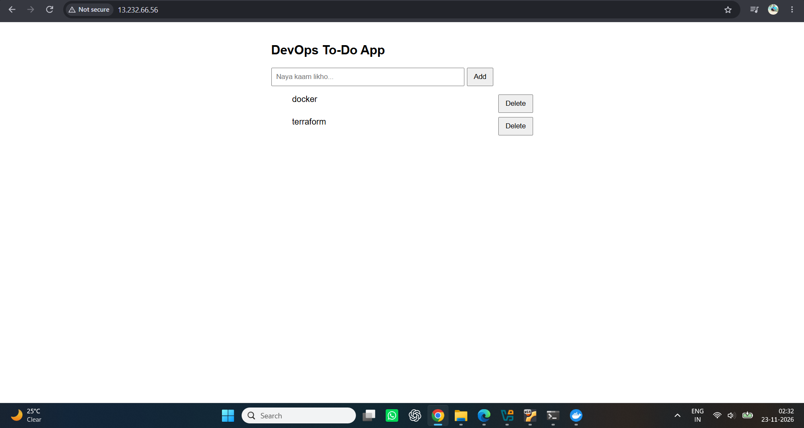
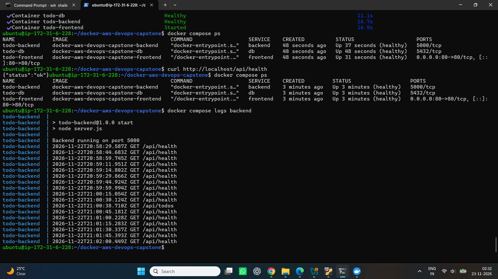
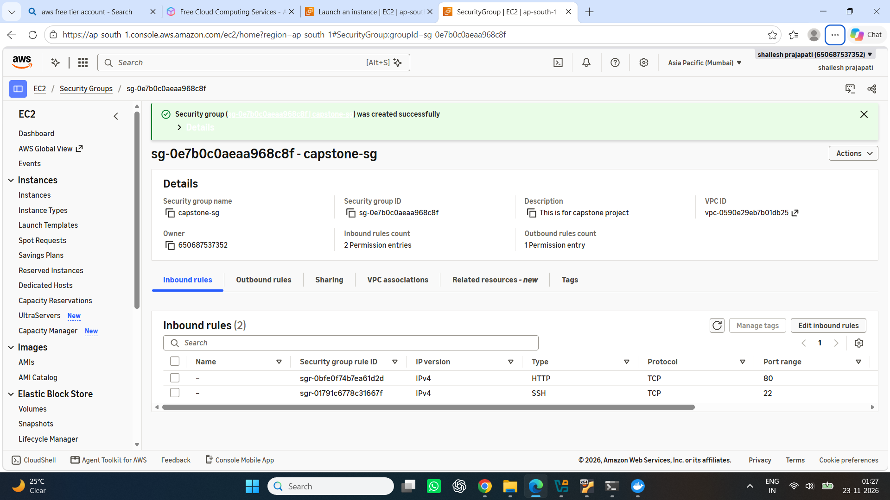

# Dockerized To-Do App on AWS EC2

A 3-tier application (Nginx frontend, Node.js/Express backend, PostgreSQL database) containerized with Docker, orchestrated with Docker Compose and deployed on AWS EC2.

## Architecture

Browser -> Nginx (frontend, port 80) -> Node.js API (backend, port 5000) -> PostgreSQL (db, port 5432)

- `frontend-net`: frontend <-> backend
- `backend-net`: backend <-> db
- Only the frontend port is exposed to the internet. Backend and DB are reachable only inside Docker networks.

## Features

- Dockerfile for each service
- Docker Compose with networks, named volume and env-based config
- Data persistence using a named volume (`pgdata`)
- Health checks on all services, with startup ordering (`depends_on` + `service_healthy`)
- Log rotation (json-file, 10 MB x 3 files) and request logging in the backend
- `restart: unless-stopped` so services survive crashes and server reboots

## Project structure

```
.
├── docker-compose.yml
├── .env.example
├── frontend/   (Dockerfile, nginx.conf, index.html)
├── backend/    (Dockerfile, package.json, server.js)
└── database/   (Dockerfile, init.sql)
```

## Run locally

```bash
cp .env.example .env      # then edit the values
docker compose up -d --build
docker compose ps
```

If port 80 is busy locally, set `HOST_PORT=8080` in `.env`.

## Deploy on AWS EC2

1. Launch an Ubuntu 24.04 EC2 instance (t3.micro, 20 GiB storage)
2. Security Group inbound rules: SSH (22) from my IP only, HTTP (80) from anywhere
3. Install Docker: `sudo apt update && sudo apt install -y docker.io docker-compose-v2 git`
4. Clone this repo, create `.env` (with `HOST_PORT=80`)
5. Run `docker compose up -d --build`
6. Open `http://<EC2-PUBLIC-IP>`

## Useful commands

```bash
docker compose ps                  # service status and health
docker compose logs -f backend     # follow backend logs
docker compose down                # stop (data is kept in the volume)
```

Never run `docker compose down -v` unless you want to delete the database data.

## Screenshots

See the `screenshots/` folder.

## Screenshot







